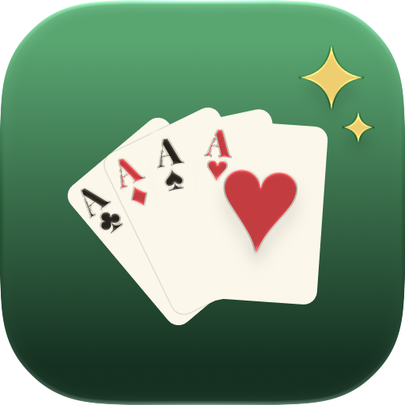

# Solitaire

A native SwiftUI Klondike game. It includes Draw 1 and Draw 3 modes, drag-and-drop stacks, tap-to-auto-place, standard scoring, undo history, saved games, a timer, stuck detection that also notices when the only moves left go in circles, and win presentation.

## Scoring

Scoring follows the standard rules of classic Windows Solitaire (`Solitaire/Models/Scoring.swift`):

| Action | Points |
| --- | --- |
| A card to a foundation | +10 |
| A waste card to a column | +5 |
| Turning over a face-down card | +5 |
| A foundation card back to a column | −15 |
| Turning the waste back over, after the first pass in Draw 1 | −100 |
| Turning the waste back over, after the third pass in Draw 3 | −20 |
| Every 10 seconds of play | −2 |

The score never drops below zero. Undo takes back a move's points but not the time penalty. Winning in more than 30 seconds adds a time bonus of 700,000 divided by the seconds taken.

## Apple platform support

- iPhone only for now, on iOS 26 or later. The project also turns off the "Designed for iPhone" run destinations for Mac and Apple Vision Pro.
- Standard SwiftUI toolbars, sheets, materials, Liquid Glass controls, haptics, and VoiceOver labels.
- Every layout shares one design: a single minimal line of stats (time, moves, points) on the board's top-left corner, with cards sized to fit both the width and the height. On iPhone Duo and other devices with a fold (iOS 27.1), a half-open fold splits the board around the reserved fold region, with the stock and waste on one side and the foundations on the other, so no card sits on the crease.
- Responsive portrait and landscape layouts, reduced-motion support, and automatic timer pause/save in the background.

## Build

Use Xcode 27.2 or later, and open the project:

```sh
open Solitaire.xcodeproj
```

Xcode keeps the `Solitaire` and `SolitaireTests` folders in sync with their targets. A file added to either folder, whether in Xcode or anywhere else, builds with that target.

Run the unit tests from Xcode or with:

```sh
xcodebuild -project Solitaire.xcodeproj -scheme Solitaire \
  -destination 'platform=iOS Simulator,name=iPhone Duo' test
```

## Release

Make release settings in Xcode. Select the project in the navigator, then the Solitaire target:

- **Signing & Capabilities**: choose your Apple Developer team, and set a bundle identifier registered to that team. Xcode manages signing automatically.
- **General**: set the version and build number. Increase the build number for every upload.

The app already includes a privacy manifest (`Solitaire/Resources/PrivacyInfo.xcprivacy`) declaring its `UserDefaults` use, and it declares that it uses no non-exempt encryption.

The support page and privacy policy for App Store Connect are published with GitHub Pages from `docs/`:

- Support URL: https://isaact135.github.io/solitaire/support/
- Privacy policy URL: https://isaact135.github.io/solitaire/privacy/

## Structure

- `Solitaire/Models`: cards, game state, rules, scoring, undo, persistence, and timing.
- `Solitaire/Views`: adaptive app shell, board layout, gestures, cards, and controls.
- `Solitaire/Resources`: the Icon Composer app icon (`AppIcon.icon`; open it in Icon Composer to edit), colors, and the privacy manifest.
- `SolitaireTests`: rule and state-restoration tests.
- `docs`: the GitHub Pages site, with the support page and privacy policy.
- `appstore`: App Store screenshots, artwork and app preview, with the listing text and what to enter where in `appstore/listing.md`.
